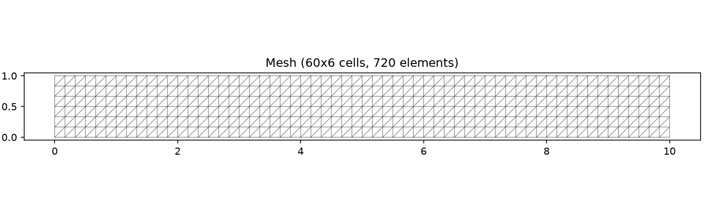
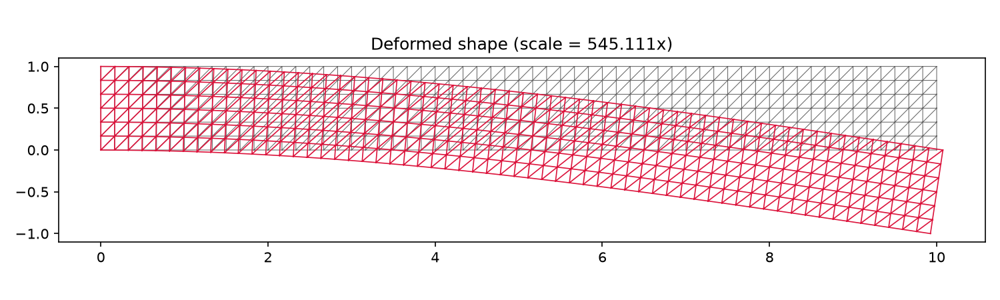
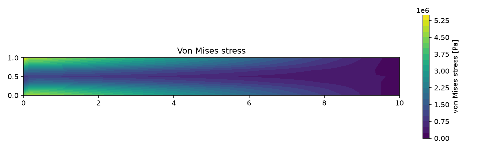
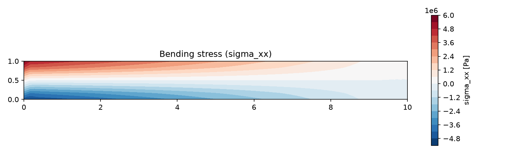
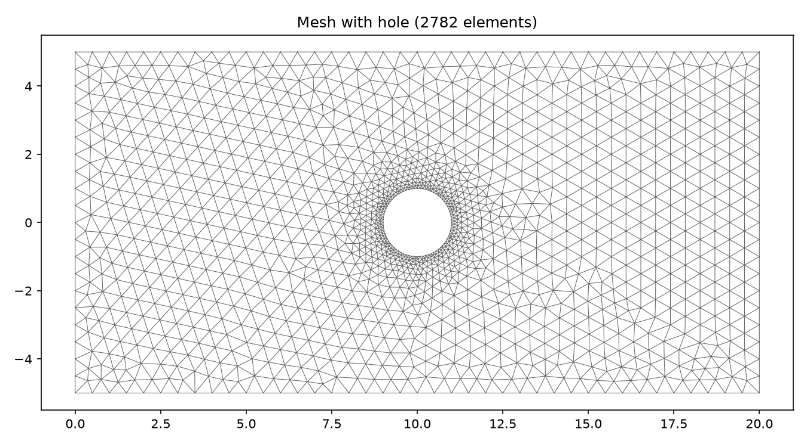
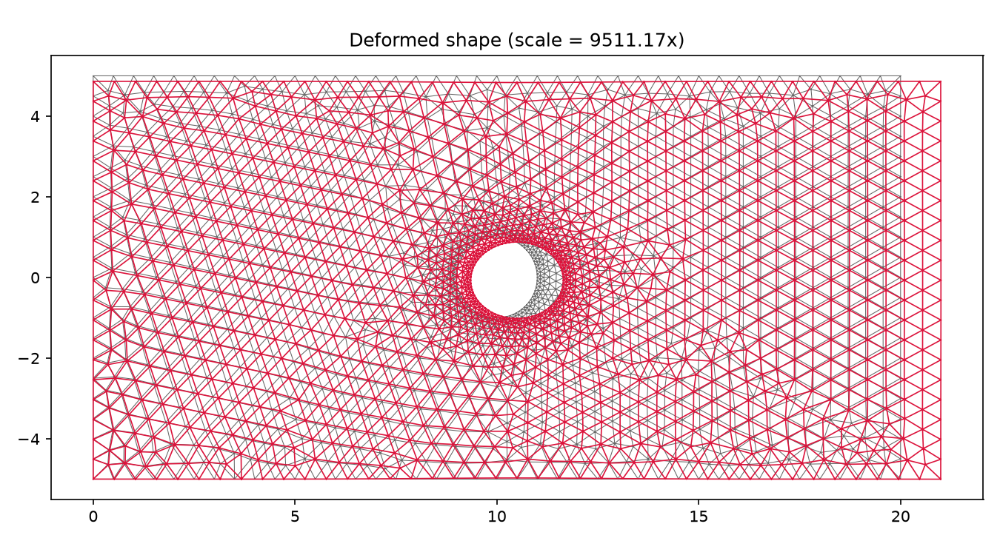
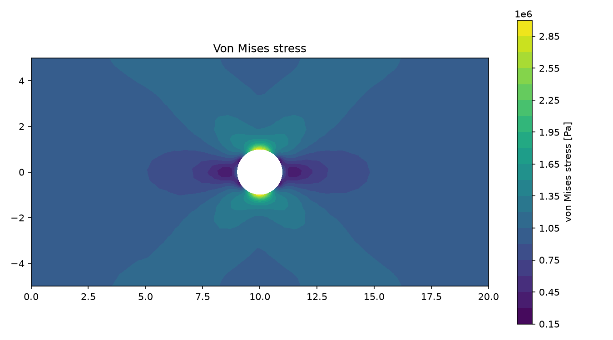
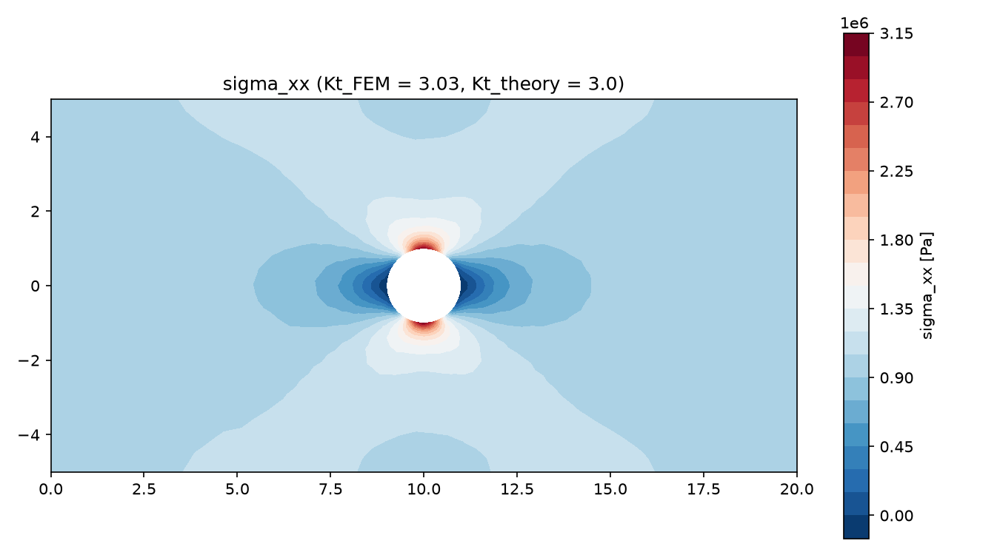
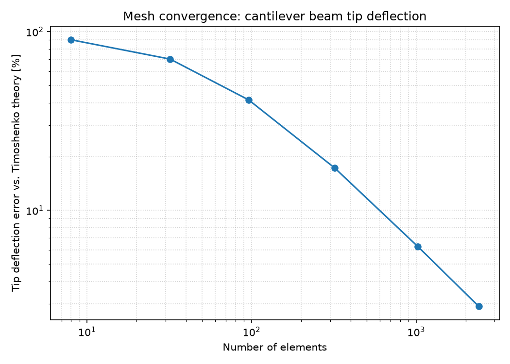

# 2D Finite Element Solver (CST Elements)

A finite element solver for 2D plane-stress linear elasticity, built from
scratch in Python: meshing, stiffness assembly, boundary conditions, solving,
post-processing, and result visualization — validated against classical
analytical solutions at every stage.

## Why this project

This project mirrors the core CAE workflow used in tools like ANSYS or
HyperWorks — model prep, meshing, analysis setup, simulation, and result
evaluation — implemented from first principles to understand what happens
under the hood.

## Features

- **Constant Strain Triangle (CST) elements** for 2D plane-stress problems
- **Structured mesh generator** for rectangular domains
- **Unstructured meshing via [gmsh](https://gmsh.info/)** for complex geometry (plate with a hole), with local mesh refinement
- **Sparse global stiffness assembly** (SciPy CSR)
- **Boundary conditions**: point loads, edge tractions, fixed supports
- **Post-processing**: strain, stress, von Mises stress, nodal averaging
- **Visualization**: mesh, deformed shape, and stress contour plots
- **25 automated tests** (pytest) validating individual elements, global assembly, and full-pipeline results against theory
- **Mesh convergence study** quantifying solver accuracy vs. mesh density

## Results

### Cantilever beam under a tip load
FEM deflection matched Timoshenko beam theory to within ~5%, and Euler-Bernoulli
theory to within ~8% (Timoshenko is expected to be closer, since it accounts
for shear deformation that CST elements naturally capture).

| | |
|---|---|
|  |  |
|  |  |

### Plate with a hole under uniaxial tension
FEM stress concentration factor **Kt = 3.03**, within **0.85%** of the
[Kirsch (1898)](https://en.wikipedia.org/wiki/Stress_concentration) analytical
solution (Kt = 3.0 for a small circular hole in a wide plate).

| | |
|---|---|
|  |  |
|  |  |

### Mesh convergence study
Deflection error vs. beam theory shrinks as the mesh is refined, converging
toward (but not reaching) the analytical solution — the known signature of
CST elements' bending stiffness bias ("shear locking").



## Project structure

```
src/fem/          Core solver: mesh, elements, assembly, boundary, solver, postprocess, plotting
validation/       Closed-form analytical solutions used to check FEM results
examples/         Runnable scripts producing the results above
tests/            25 pytest tests (element-level, assembly-level, full-pipeline)
results/          Saved plots from each example
docs/             Technical report and theory notes
```

## Setup

```bash
python -m venv venv
venv\Scripts\activate          # Windows
pip install -e .
pytest -v                      # run all 25 tests
python examples/01_cantilever_beam.py
python examples/02_plate_with_hole.py
python examples/03_mesh_convergence.py
```

## Technical report

See [docs/report.md](docs/report.md) for full methodology, validation results,
and discussion of CST element limitations.

## Tech stack

Python, NumPy, SciPy (sparse linear algebra), Matplotlib, gmsh, pytest