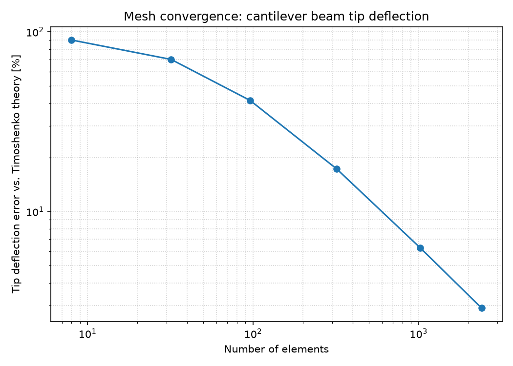

# Technical Report: 2D Finite Element Solver for Plane-Stress Problems

**Author:** Kashvi Sharma
**Date:** [today's date]
**Repository:** [GitHub link, add after Step 10]

## 1. Objective

To develop and validate a finite element solver for 2D linear-elastic
plane-stress problems, covering the full CAE workflow: model definition,
meshing, analysis setup, solution, and result evaluation — and to
quantify solver accuracy against classical analytical solutions.

## 2. Methodology

### 2.1 Element formulation
A 3-node Constant Strain Triangle (CST) element was implemented from
first principles: the strain-displacement matrix `B` and element
stiffness `Ke = t*A*B^T*D*B` were derived and coded directly (see
`docs/theory.md` for the full derivation).

### 2.2 Meshing
Two meshing approaches were used:
- A structured rectangular mesh generator (for the cantilever beam and
  convergence study)
- Unstructured meshing via `gmsh`, with local refinement near geometric
  features (for the plate with a hole)

### 2.3 Assembly and solution
Element stiffness matrices were assembled into a global sparse stiffness
matrix (`scipy.sparse`). Boundary conditions were applied by partitioning
the system into free and fixed degrees of freedom, and the reduced system
was solved with `scipy.sparse.linalg.spsolve`.

### 2.4 Validation strategy
Rather than validating only the final result, each stage of the pipeline
was checked independently before moving to the next:
1. Single-element checks: symmetry, rigid-body modes, patch test (25
   automated tests total)
2. Global equilibrium: applied loads vs. reaction forces
3. Full-pipeline validation against three independent analytical solutions

## 3. Results

### 3.1 Uniaxial tension (exact solution check)
A uniformly loaded rectangular bar was solved and compared to the exact
elasticity solution. Since uniform stress lies exactly within the CST's
solution space, the FEM result matched the analytical solution to solver
precision (error < 1e-6), confirming the element formulation, assembly,
and solver were implemented correctly before testing bending-dominated
cases.

### 3.2 Cantilever beam under a tip load
| Quantity | FEM | Theory (Timoshenko) | Error |
|---|---|---|---|
| Tip deflection | [your v_fem] m | [your v_theory] m | [your %]% |

The Timoshenko comparison (which includes shear deformation) was closer
than the Euler-Bernoulli comparison ([your Euler %]% error), as expected,
since CST elements naturally capture shear deformation.

### 3.3 Plate with a hole under uniaxial tension
| Quantity | FEM | Theory (Kirsch) | Error |
|---|---|---|---|
| Stress concentration factor Kt | 3.03 | 3.00 | 0.85% |

### 3.4 Mesh convergence study
Tip deflection error was evaluated across 6 mesh densities from 8 to
[your final] elements. Error decreased monotonically with mesh
refinement, from [coarsest %]% to [finest %]%, converging toward but not
reaching the analytical solution.

## 4. Discussion: CST element limitations

The persistent gap between FEM and theory in the bending case, even at
fine mesh resolution, is a known characteristic of CST elements called
**shear locking**. Because CST elements assume a linear (and therefore
constant-curvature-free) displacement field within each element, they
cannot represent the curvature present in true bending deformation,
making the element artificially stiff. This is why the uniaxial tension
case (a uniform stress field, exactly representable by CST) matched
theory almost exactly, while the bending case did not.

A natural extension of this work would be implementing 6-node quadratic
triangles (LST elements), which include mid-side nodes and can represent
linearly varying strain, substantially reducing shear locking.

## 5. Debugging note: unit-consistency bug

During validation of the cantilever beam case, an early implementation
applied traction as force-per-unit-length rather than force-per-unit-area,
causing an ~90% deflection error. This was caught specifically because
the result was checked against Timoshenko beam theory rather than assumed
correct — a concrete example of why full-pipeline validation against
independent analytical solutions matters, not just checking that code
runs without error.

## 6. Conclusion

A working 2D FEM solver was implemented and validated across three
independent analytical benchmarks, achieving errors ranging from
solver-precision (uniaxial tension) to under 5-8% (bending, limited by
known CST element behavior) to under 1% (stress concentration). The
project demonstrates the full CAE workflow: model preparation, meshing
(both structured and gmsh-based unstructured), analysis setup, simulation,
and result evaluation, along with the debugging and validation discipline
required to trust simulation results.